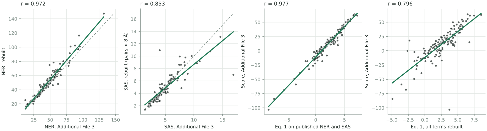

# Rebuilt ASH (PMC1955748)

ASH's code is gone, so this is our own ASH, written from the papers. Its first test is
Additional File 3, the only place the paper prints ASH's numbers per structure pair: NER, SAS,
sequence identity and the ASH score, for 69 queries against their top false positive and their
best true template (138 pairs).

## What is rebuilt, and from where

| Part | Source | Status |
| --- | --- | --- |
| NER, eq. 2 and 3 (d0 = 4 Å) | 2007 paper | as written |
| NER maximization: RMSD fit, then NER maximized over the superposition by Polak-Ribiere conjugate gradients, then realignment by dynamic programming on exp(−(d/4 Å)²), internal gap opening 0.25 and extension 0.125, terminal gaps free | 2005 GASH paper, "NER maximization" | as written |
| Seed alignments | Local ASH (double dynamic programming, 14 Å local environments, up to 25 alignments) | **two stand-ins**: one TM-align alignment (`tmtools`, the default), and our rebuild of Local ASH (`pipeline/localash.py`, run with `--extended`) |
| Score terms: Fseq with Additional File 2, SAS, internal gaps between the 0.55 boundaries, Dist with the Table 1 descriptors | 2007 paper, eq. 1, 4 to 6, Table 1 | as written, with the two readings below |
| Helix and strand residues for Dist | not stated | DSSP rules (`pipeline/ss.py`) |
| Domains | CATH 3.0.0 boundaries on today's PDB entries, ATOM records only | 187 of 190 lengths equal Additional File 3's; three differ by one residue |

Two readings were chosen by fitting to Additional File 3, and so are not independent of it:

- **NER_rel in percent.** Eq. 2 defines NER_rel as a fraction (0 to 1). With the printed
  weights, only NER_rel × 100 matches the published scores: r = 0.977 against 0.764 as a fraction.
- **SAS over aligned pairs closer than 8 Å.** Over all aligned pairs our SAS runs about 1.8
  times the published one. The paper does not say which pairs SAS uses.

## Results



| Quantity | Correlation with Additional File 3 | Median difference |
| --- | --- | --- |
| NER | 0.972 | 3.1. Ours is 3.9 higher on average: 12 pairs more than 10 higher, 1 more than 10 lower. |
| SAS, pairs within 8 Å | 0.853 | 0.28 |
| Sequence identity, % of aligned pairs | 0.671 | 1.6 |
| Score: eq. 1 on the published NER and SAS | **0.977** | published ≈ 10.6 × eq. 1 − 10.9 |
| Score: eq. 1, every term ours | 0.796 | published ≈ 9.1 × eq. 1 − 11.8 |

- **The score formula holds.** Fed the published NER and SAS, eq. 1 with the paper's weights
  (full training set) and our Fseq, gaps and Dist gives the published scores at r = 0.977. The
  printed scores are about ten times eq. 1, minus about 11; the paper does not mention either.
- **The aligner does not reproduce ASH's alignments.** Our NER is close, and often higher: the
  TM-align seed finds as much superposable structure as ASH did. But the alignments differ in
  which residues pair up, so SAS, sequence identity and the score scatter more. In the paper's
  question per row, does the false positive outscore the true template, Additional File 3 says
  yes in 62 of 69 rows and we say yes in 44; we agree on 51.

## Seeds and the final step

To find where the alignments part, we rebuilt Local ASH too, and varied the last step of NER
maximization. On the same 138 pairs:

| Variant | NER r | SAS r (pairs < 8 Å) | Score r, every term ours |
| --- | --- | --- | --- |
| TM-align seed (default) | 0.972 | 0.853 | 0.796 |
| Rebuilt Local ASH seeds | 0.972 | 0.855 | 0.783 |
| NER read before the final maximization | 0.971 | 0.855 | 0.796 |
| Gap of length L costs 0.25 + L × 0.125 | 0.966 | 0.847 | 0.790 |
| Superposition and realignment iterated | 0.972 | 0.853 | 0.796 |

None of them moves the score. On the 66 pairs where our NER is within 3 of the published one,
our SAS agrees with Additional File 3 at r = 0.95 to 0.97 for any cutoff from 4 to 10 Å
(`sas_cutoff_scan` in `output/af3_comparison.json`). So the gap is not in the SAS definition:
it comes from the other 72 pairs, where ASH settled on an alignment that neither seed set leads
to. Without ASH's code those cannot be recovered.

Rebuilt Local ASH follows the 2005 paper (beta-carbon local environments within 14 Å, gaps 10
and 0.5 at both DP levels, Smith-Waterman upper level, up to 25 alignments, sub-alignments that
agree within 10 Å), the 2007 paper (a ±10 residue window, lower DP only for residues with the
same secondary structure) and Toh's patent, US 6,125,331 (the vector score a / (|ΔV|² + b);
s(i, j) = 0 for skipped residue pairs). It fixes what none of them gives: a = 100 and b = 10,
the local frame, a virtual beta carbon from the backbone, and Smith-Waterman scores shifted by
their mean.

## Layout

| Path | Content |
| --- | --- |
| `main.nf`, `nextflow.config` | Nextflow pipeline. |
| `pipeline/ash.py` | NER, NER maximization, dynamic programming (numba), score terms, eq. 1. |
| `pipeline/domains.py` | Downloads PDB entries from RCSB and cuts CATH 3.0.0 domains. |
| `pipeline/ss.py` | Helix and strand assignment by the DSSP rules. |
| `pipeline/localash.py` | Rebuilt Local ASH: double dynamic programming seeds, parsing, best NER. |
| `pipeline/tmseed.py` | The TM-align seed. |
| `pipeline/af3_test.py` | Aligns the 138 pairs (`tm` or `ddp` seeds). |
| `pipeline/compare_af3.py` | Compares with Additional File 3; writes the figure and the report. |
| `pipeline/final_variants.py` | The variants of the final step. |
| `output/` | `af3_pairs.json` (every term per pair, with the aligned pairs and their distances), `af3_comparison.json`, `af3_scatter.png`, `report.md`; `local-ash/` (the same with Local ASH seeds); `final_variants.json`, `final_variants.md`. |

## Run

Requirements: Python 3 with numpy, scipy, xlrd, gemmi, numba, tmtools and matplotlib; Nextflow
with Java 17 or later.

```sh
nextflow run PMC1955748/ash-rebuild/main.nf --outdir results
nextflow run PMC1955748/ash-rebuild/main.nf --outdir results --extended   # also Local ASH seeds and the variants, about 20 minutes
```

The run takes Additional File 3 and CATH 3.0.0's boundaries through
`../figure-reproduction/pipeline/fetch_inputs.sh` (SHA-256 checked), downloads the 187 PDB entries
from RCSB, and takes under a minute on four cores. It fails if eq. 1 on the published NER and SAS
drops below r = 0.97, or our NER below r = 0.95.

## Limits

- PDB entries are today's remediated files, not the 2006 ones ASH read.
- Neither seed set is ASH's own. Rebuilt Local ASH fixes four settings the sources do not give.
- The Python Local ASH takes about 20 s per domain pair on one core, too slow for Fig. 1's
  millions of pairs; the TM-align route takes under a second.
- The scale of about 10 and offset of about −11 in the published scores are fitted, not derived.
