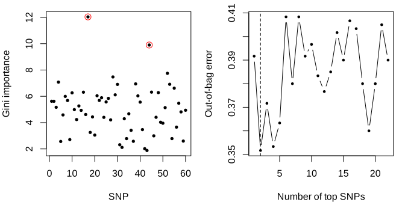

epiforest tutorial
================

## What the method does

epiForest screens a case-control SNP data set for interacting loci in
two stages. A random forest with every SNP as a three-level factor ranks
the SNPs by gini importance; a sliding window sequential forward feature
selection (SWSFS) adds SNPs in that order and keeps the first set whose
out-of-bag error is the smallest in a window of 20. The kept candidates
are then tested one, two and three at a time with the B statistic of
Zhang and Liu (2007), Bonferroni-corrected for all the SNPs screened.

> Jiang R, Tang W, Wu X, Fu W. A random forest approach to the detection
> of epistatic interactions in case-control studies. *BMC
> Bioinformatics* 10(Suppl 1):S65 (2009).
> [doi:10.1186/1471-2105-10-S1-S65](https://doi.org/10.1186/1471-2105-10-S1-S65)

The authors’ program is lost; this package rebuilds the method from the
paper’s text.

## Install

``` r
remotes::install_github("jeonglab-bcm/fossil/PMC2648748/package")
```

``` r
library(epiforest)
packageVersion("epiforest")
#> [1] '0.1.0'
```

## Example input

The bundled example has 300 cases and 300 controls genotyped at 60 SNPs,
simulated from the paper’s threshold model (model 3); `snp17` and
`snp44` are the disease loci.

``` r
ex <- read_genotypes(example_path())
dim(ex$geno)
#> [1] 600  60
table(status = ex$status)
#> status
#>   0   1 
#> 300 300
ex$geno[1:5, 1:8]
#>      snp1 snp2 snp3 snp4 snp5 snp6 snp7 snp8
#> [1,]    0    1    1    1    1    2    1    0
#> [2,]    0    0    1    2    0    0    2    0
#> [3,]    1    1    2    1    0    1    1    2
#> [4,]    0    1    1    1    1    1    2    0
#> [5,]    0    0    0    0    0    1    1    0
```

## Run epiForest

``` r
fit <- epiforest(ex$geno, ex$status, ntree = 500, window = 20, seed = 1)
fit$swsfs$k                          # candidates kept by SWSFS
#> [1] 2
colnames(ex$geno)[fit$candidates]
#> [1] "snp17" "snp44"
reported <- fit$tests[fit$tests$reported, c("order", "snps", "given", "B", "df", "p", "p_adj")]
reported$snps <- vapply(strsplit(reported$snps, ","),
                        function(z) paste(colnames(ex$geno)[as.integer(z)], collapse = ","), "")
reported
#>   order  snps given         B df            p        p_adj
#> 1     1 snp17       10.724398  2 1.466769e-07 8.800614e-06
#> 2     1 snp44        5.028548  2 4.365542e-05 2.619325e-03
colnames(ex$geno)[fit$identified]
#> [1] "snp17" "snp44"
```

``` r
op <- par(mfrow = c(1, 2), mar = c(4, 4, 1, 1))
plot(fit$gini, pch = 19, cex = 0.6, xlab = "SNP", ylab = "Gini importance")
points(fit$order[1:2], fit$gini[fit$order[1:2]], col = "red", cex = 1.4)
plot(fit$swsfs$errors, type = "b", pch = 19, cex = 0.5, xlab = "Number of top SNPs",
     ylab = "Out-of-bag error")
abline(v = fit$swsfs$k, lty = 2)
```

<!-- -->

``` r
par(op)
```

## Compare with the expected output

`example_expected.csv` was written by the script that generated the
data, from its own NumPy and SciPy code: which SNPs are the disease
loci, their B statistics and chi-squared tests.

``` r
expected <- read.csv(example_path("example_expected.csv"), stringsAsFactors = FALSE)
expected
#>           test        snps statistic df     shift            p
#> 1            B       snp17 10.724398  2 -10.02127 1.466769e-07
#> 2            B       snp44  5.028548  2 -10.02127 4.365542e-05
#> 3            B snp17;snp44 20.237472  8 -33.54975 7.731813e-13
#> 4        chisq       snp17 31.073041  2        NA 1.788854e-07
#> 5        chisq       snp44 19.964697  2        NA 4.620841e-05
#> 6 disease_snps snp17;snp44        NA NA        NA           NA
col_of <- function(s) match(strsplit(s, ";")[[1]], colnames(ex$geno))
ok <- c()
for (i in which(expected$test == "B")) {
  b <- b_test(ex$geno, ex$status, matrix(col_of(expected$snps[i]), nrow = 1))
  ok[paste("B", expected$snps[i])] <- isTRUE(all.equal(c(b$B, b$p),
    c(expected$statistic[i], expected$p[i]), tolerance = 1e-8))
}
cs <- chisq_single(ex$geno, ex$status)
for (i in which(expected$test == "chisq")) {
  j <- col_of(expected$snps[i])
  ok[paste("chisq", expected$snps[i])] <- isTRUE(all.equal(c(cs$statistic[j], cs$p[j]),
    c(expected$statistic[i], expected$p[i]), tolerance = 1e-8))
}
disease <- col_of(expected$snps[expected$test == "disease_snps"])
ok["disease SNPs identified"] <- all(disease %in% fit$identified)
ok
#>                 B snp17                 B snp44           B snp17;snp44 
#>                    TRUE                    TRUE                    TRUE 
#>             chisq snp17             chisq snp44 disease SNPs identified 
#>                    TRUE                    TRUE                    TRUE
cat(sum(ok), "of", length(ok), "checks match the expected output\n")
#> 6 of 6 checks match the expected output
stopifnot(all(ok))
```

## Your own data

`read_genotypes()` reads a CSV file with a `status` column (1 case, 0
control) and one column per SNP holding 0, 1 or 2 copies of the minor
allele, with no missing values (impute or drop them first).
`epiforest()` takes the genotype matrix and the status vector:

- `ntree`: trees per forest. The paper used one million trees for its
  genome-wide data and does not say how many for its simulations; 500
  (randomForest’s default) is fast, more trees give a smoother
  out-of-bag error curve and usually a larger candidate set.
- `window`: the SWSFS window (20 in the paper).
- `alpha`, `max_order`: the significance level and the highest
  interaction order tested.

The result holds `gini` (one value per SNP), `swsfs$errors` (the
out-of-bag error of each forest built), `candidates`, `tests` (every
test with its B statistic, degrees of freedom, p-value,
Bonferroni-adjusted p-value and whether it is reported; `given` lists
the SNPs a conditional test conditions on) and `identified` (the SNPs in
a reported test). The comparators of the paper, `chisq_single()` and
`stepwise_lr()`, and its simulation design, `simulate_dataset()`, are
also in the package.

## The paper’s full study

The reproduction of the paper’s simulation study (Figs 2 and 3) with
this package, and what came back, is in
[`PMC2648748/`](https://github.com/jeonglab-bcm/fossil/tree/main/PMC2648748)
of the fossil repository; the results page is
<https://jeonglab-bcm.github.io/fossil/PMC2648748/>.
