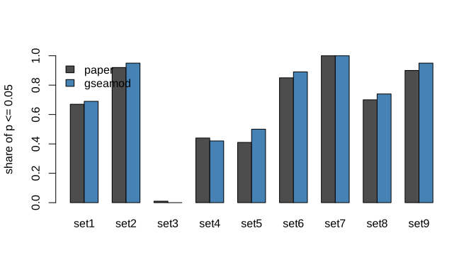

gseamod tutorial
================

## What it does

`gseamod` tests whether a gene set is enriched for differential
expression between two classes, built from the five modules of Ackermann
and Strimmer (2009): a gene-level statistic, an optional transformation,
a gene set statistic and a significance assessment, plus the global
tracks (globaltest and Hotelling’s T-squared with a shrinkage
correlation). The paper’s recommendation is the mean of the squared
moderated t statistics, with gene sampling or sample label permutation.

Ackermann M, Strimmer K. A general modular framework for gene set
enrichment analysis. *BMC Bioinformatics* 10:47 (2009).
<doi:10.1186/1471-2105-10-47>. The authors’ R code is lost; this package
was rebuilt from the paper’s text in the
[fossil](https://github.com/jeonglab-bcm/fossil) repository.

## Install

``` r
install.packages("remotes")
remotes::install_github("jeonglab-bcm/fossil/PMC2661051/package")
```

``` r
library(gseamod)
packageVersion("gseamod")
#> [1] '0.1.0'
```

## Example input

One data set of the paper’s simulation study: 600 genes by 20 samples,
two classes of 10, and nine gene sets of 20 genes each.

``` r
X <- as.matrix(read.csv(example_path("sim_expression.csv"), row.names = 1, check.names = FALSE))
y <- read.csv(example_path("sim_labels.csv"))$class
sets <- read_gmt(example_path("sim_sets.gmt"))
dim(X)
#> [1] 600  20
X[1:3, 1:5]
#>          s01     s02    s03     s04     s05
#> g001 -0.8514 -0.2723 1.2192  0.9890  0.6976
#> g002  0.2738  0.4745 1.0512 -0.6584  0.0685
#> g003 -0.1789  0.5145 0.7285 -0.8888 -0.4726
table(y)
#> y
#>  0  1 
#> 10 10
lengths(sets)
#> set1 set2 set3 set4 set5 set6 set7 set8 set9 
#>   20   20   20   20   20   20   20   20   20
```

Sets 1 and 2 are shifted up by 0.75 (set 1 with correlation 0.6), sets 6
and 7 hold 10 genes shifted up and 10 down by 1, sets 4, 5, 8 and 9 mix
half of such genes with background genes, and set 3 is 20 background
genes (no effect).

## Run the method

The recommended combination, with both significance assessments:

``` r
q1 <- gsea(X, y, sets, gene = "modt", transform = "square", setstat = "mean",
           method = "resampling", B = 1000, seed = 1)
q2 <- gsea(X, y, sets, gene = "modt", transform = "square", setstat = "mean",
           method = "permutation", B = 1000, seed = 1)
data.frame(set = q1$set, statistic = round(q1$statistic, 3), p_resampling = q1$p, p_permutation = q2$p)
#>    set statistic p_resampling p_permutation
#> 1 set1     6.558        0.000         0.000
#> 2 set2     6.235        0.000         0.000
#> 3 set3     1.005        0.919         0.493
#> 4 set4     3.605        0.013         0.001
#> 5 set5     3.219        0.026         0.000
#> 6 set6     7.423        0.000         0.003
#> 7 set7     7.129        0.000         0.000
#> 8 set8     4.681        0.000         0.002
#> 9 set9     4.535        0.001         0.000
```

Without the squaring, the sets with genes shifted both ways (6 to 9) are
missed:

``` r
gsea(X, y, sets, transform = "none", setstat = "mean", method = "resampling", B = 1000, seed = 1)$p
#> [1] 0.000 0.000 0.682 0.000 0.000 0.664 0.338 0.823 0.150
```

The global and multivariate tracks:

``` r
gsea(X, y, sets, setstat = "hotelling", method = "permutation", B = 200, seed = 1)$p
#> [1] 0.045 0.000 0.395 0.040 0.000 0.060 0.000 0.000 0.000
```

## Compare with the expected output

The paper reports, for 100 simulated data sets, the share in which each
set was significant at p \<= 0.05 (Table 4, resampling column). We
simulate 100 data sets with `simulate_ackermann()` and compare our
shares with the printed ones within Monte Carlo error
(`rate_tolerance()`, a 99% band for two shares of 100).

``` r
expected <- read.csv(example_path("paper_table4_resampling.csv"), colClasses = "character")
p <- t(vapply(1:100, function(r) {
  d <- simulate_ackermann(seed = 2009 + r)
  gsea(d$X, d$y, d$sets, gene = "modt", transform = "square", setstat = "mean",
       method = "resampling", B = 1000, seed = r)$p
}, numeric(9)))
colnames(p) <- paste0("set", 1:9)
ours <- detection_rates(p)
cmp <- data.frame(set = expected$set, paper = expected$detection_rate, ours = ours[expected$set],
                  tolerance = round(rate_tolerance(expected$detection_rate, ours[expected$set]), 3))
cmp$agrees <- abs(as.numeric(cmp$paper) - cmp$ours) <= cmp$tolerance
cmp
#>       set paper ours tolerance agrees
#> set1 set1  0.67 0.69     0.175   TRUE
#> set2 set2  0.92 0.95     0.098   TRUE
#> set3 set3  0.01 0.00     0.041   TRUE
#> set4 set4  0.44 0.42     0.185   TRUE
#> set5 set5  0.41 0.50     0.186   TRUE
#> set6 set6  0.85 0.89     0.129   TRUE
#> set7 set7  1.00 1.00     0.031   TRUE
#> set8 set8  0.70 0.74     0.169   TRUE
#> set9 set9  0.90 0.95     0.103   TRUE
cat(sum(cmp$agrees), "of", nrow(cmp), "sets agree with Table 4 of the paper\n")
#> 9 of 9 sets agree with Table 4 of the paper
stopifnot(all(cmp$agrees))
```

``` r
barplot(rbind(as.numeric(cmp$paper), cmp$ours), beside = TRUE, names.arg = cmp$set,
        col = c("grey30", "steelblue"), ylim = c(0, 1), ylab = "share of p <= 0.05",
        legend.text = c("paper", "gseamod"), args.legend = list(x = "topleft", bty = "n"))
```

<!-- -->

## Your own data

- `X`: a numeric matrix with genes in rows and samples in columns, on a
  log scale; row names are gene identifiers. `read_gct()` reads GSEA’s
  GCT files.
- `y`: one 0/1 label per column (`read_cls()` reads GSEA’s CLS files;
  convert its labels with `as.numeric(cls == "MUT")` or similar).
- `sets`: a named list of gene sets, as row names or row indices
  (`read_gmt()` reads GMT files). Genes not in `X` are dropped.

Options that matter: `gene` (`"modt"`, `"t"`, `"corr"`), `transform`
(`"square"`, `"none"`, `"ranksq"`, `"binary"`, `"lfdr"`), `setstat`
(`"mean"`, `"median"`, `"maxmean"`, `"es"`, `"wilcoxon"`, `"condfdr"`,
`"globaltest"`, `"hotelling"`), `method` (`"permutation"` for the
self-contained null hypothesis, `"resampling"` for the competitive one,
`"restandardization"`, `"parametric"`) and `B`.

The output has one row per set: `set`, `size` (genes found in `X`),
`statistic` (larger is more enriched) and `p` (one-sided). With `B`
draws the smallest p-value is 0, meaning below 1/`B`.

## The reproduction

The paper’s simulation tables, its p53 and Hedenfalk analyses and the
comparison with every published number are in the [PMC2661051
folder](https://github.com/jeonglab-bcm/fossil/tree/main/PMC2661051) and
on the [results
page](https://jeonglab-bcm.github.io/fossil/PMC2661051/).
