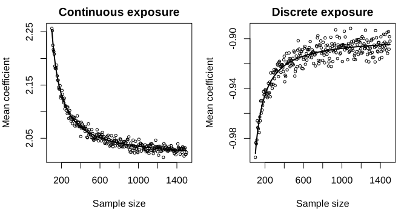

logitbias tutorial
================

Logistic regression overestimates odds ratios in small samples: the
maximum likelihood coefficient is biased away from zero by about
`b1 / n`. `logitbias` estimates `b1` the way Nemes et al. did: draw many
samples of each size from a population, fit a logistic regression to
each, and fit the mean coefficient against `1/n` by ordinary least
squares. The intercept of that fit is the large-sample value and the
slope is `b1`. It also gives the analytic first-order bias of the
estimator for a population, and the bias-corrected estimate.

Nemes S, Jonasson JM, Genell A, Steineck G. Bias in odds ratios by
logistic regression modelling and sample size. *BMC Medical Research
Methodology* 9:56 (2009).
[doi:10.1186/1471-2288-9-56](https://doi.org/10.1186/1471-2288-9-56)

## Install

``` r
remotes::install_github("jeonglab-bcm/fossil/PMC2724427/package")
```

``` r
library(logitbias)
packageVersion("logitbias")
#> [1] '0.1.0'
```

## Example input

The bundled example holds a mean coefficient for each sample size from
100 to 1500 in steps of 5, for a continuous exposure `x` and a discrete
exposure `z`, the shape of the paper’s Fig. 1. The means are synthetic:
drawn around the curves of the paper’s Table 1 (see
`example_path("README.md")`).

``` r
m <- read.csv(example_path("means_example.csv"))
dim(m)
#> [1] 562   3
head(m)
#>     n term     mean
#> 1 100    x 2.256439
#> 2 105    x 2.252344
#> 3 110    x 2.224704
#> 4 115    x 2.216399
#> 5 120    x 2.213037
#> 6 125    x 2.208200
```

## Fit the bias curve

``` r
fit <- fit_bias_curve(m)
fit[, c("term", "param", "estimate", "se", "t", "r2")]
#>   term     param   estimate           se           t        r2
#> 1    x intercept  2.0105703 0.0005579538  3603.47099 0.9787100
#> 2    x     inv_n 24.1880187 0.2135790371   113.25090 0.9787100
#> 3    z intercept -0.8983923 0.0005255421 -1709.45834 0.8859546
#> 4    z     inv_n -9.3656259 0.2011721662   -46.55528 0.8859546
```

``` r
op <- par(mfrow = c(1, 2), mar = c(4, 4, 2, 1))
for (tm in c("x", "z")) {
  d <- m[m$term == tm, ]
  b <- fit$estimate[fit$term == tm]
  plot(d$n, d$mean, cex = 0.6, xlab = "Sample size", ylab = "Mean coefficient",
       main = if (tm == "x") "Continuous exposure" else "Discrete exposure")
  lines(d$n, b[1] + b[2] / d$n, lwd = 2)
}
```



``` r
par(op)
```

## Compare with the expected output

The expected output is the pair of values each curve was drawn from,
with a tolerance of four standard errors.

``` r
e <- read.csv(example_path("means_example_expected.csv"))
cmp <- merge(fit[, c("term", "param", "estimate")], e, by = c("term", "param"))
cmp$within <- abs(cmp$estimate - cmp$value) <= cmp$tolerance
cmp
#>   term     param   estimate  value tolerance within
#> 1    x intercept  2.0105703  2.011   0.00215   TRUE
#> 2    x     inv_n 24.1880187 23.900   0.82200   TRUE
#> 3    z intercept -0.8983923 -0.898   0.00215   TRUE
#> 4    z     inv_n -9.3656259 -9.524   0.82200   TRUE
cat(sum(cmp$within), "of", nrow(cmp), "parameters match the expected output\n")
#> 4 of 4 parameters match the expected output
stopifnot(all(cmp$within))
```

## Run a small simulation

`simulate_population()` draws the paper’s population of 100,000
(Additional file 1); `bias_simulation()` draws samples of each size and
fits each one. Samples in which a fitted probability reaches 0 or 1
(separation, no finite estimate) are left out and counted. Here five
sizes and 200 samples per size keep it quick; the paper used 281 sizes
and 1,000 samples.

``` r
pop <- simulate_population(100000, seed = 1)
sim <- bias_simulation(pop, sizes = c(100, 200, 400, 800, 1500), reps = 200, seed = 1)
sim$summary[, c("n", "term", "mean", "sd", "used", "dropped")]
#>       n term       mean        sd used dropped
#> 1   100    x  2.2170425 1.0573053  170      30
#> 2   100    z -0.9059663 0.9314349  170      30
#> 3   200    x  2.1437978 0.6305034  196       4
#> 4   200    z -0.9987267 0.8870837  196       4
#> 5   400    x  2.0400404 0.4101250  200       0
#> 6   400    z -0.9685804 0.5224397  200       0
#> 7   800    x  2.0613560 0.3153427  200       0
#> 8   800    z -0.9173339 0.3714319  200       0
#> 9  1500    x  2.0002497 0.2056887  200       0
#> 10 1500    z -0.9179987 0.2462086  200       0
fit_bias_curve(sim$summary)[, c("term", "param", "estimate", "se")]
#>   term     param   estimate         se
#> 1    x intercept  2.0072273 0.01951155
#> 2    x     inv_n 21.9579274 3.77947811
#> 3    z intercept -0.9451895 0.03125234
#> 4    z     inv_n  0.8931294 6.05372428
```

The analytic first-order bias of the same population gives `b1` without
any sampling:

``` r
round(analytic_bias(pop), 2)
#> (Intercept)           x           z 
#>       -2.11       24.83      -12.48
```

A coefficient of 2.3 estimated from 150 people, with `b1 = 24`, corrects
to:

``` r
bias_correct(2.3, b1 = 24, n = 150)
#> [1] 2.14
```

## Your own data

- `fit_bias_curve(summary)` takes a data frame with columns `n` (sample
  size), `term` (coefficient name) and `mean` (mean estimate at that
  size). With `data = "all"` it also needs `used` (number of estimates)
  and `var` (their variance), and fits every estimate instead of the
  means.
- `bias_simulation(population, sizes, reps, seed)` takes a data frame
  with a 0/1 column `y` and numeric covariates. `drop` chooses which
  fits to leave out: `"boundary"` (any fitted probability within `1e-8`
  of 0 or 1), `"warning"` (only fits R warns about) or `"none"`. `cores`
  runs sizes in parallel; the result does not depend on it.
- Output columns of `fit_bias_curve()`: `estimate` is the large-sample
  coefficient (`intercept`) or `b1` (`inv_n`), with its standard error,
  t, p, the R squared of the fit and its degrees of freedom.
- `analytic_bias(population)` returns `b1` for each coefficient from the
  population’s design; `bias_correct(estimate, b1, n)` subtracts
  `b1 / n`.

## The paper’s full study

The reproduction runs the paper’s whole design (281 sizes, 1,000 samples
each, 20 populations) and compares it with Table 1 and Figs 1 to 3:
results page <https://jeonglab-bcm.github.io/fossil/PMC2724427/>,
pipeline
<https://github.com/jeonglab-bcm/fossil/tree/main/PMC2724427/figure-reproduction>.
