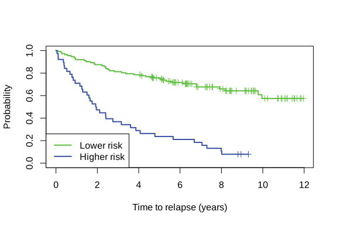

pdscox tutorial
================

## What the method does

Huang et al. turn a gene expression profile into one pathway
deregulation score (PDS) per pathway with pathifier, fit a Cox model
with an L1 (LASSO) penalty to the scores to select a few prognostic
pathways, and split tumours into higher and lower risk of relapse by the
model’s prognostic index. The same steps work on clinical features, or
on both together.

Huang S, Yee C, Ching T, Yu H, Garmire LX. A novel model to combine
clinical and pathway-based transcriptomic information for the prognosis
prediction of breast cancer. *PLoS Comput Biol* 10(9):e1003851 (2014).
<doi:10.1371/journal.pcbi.1003851>.

## Install

``` r
remotes::install_github("jeonglab-bcm/fossil/PMC4168973/package")
```

``` r
library(pdscox)
packageVersion("pdscox")
#> [1] '0.1.0'
```

## Example input

Two examples ship with the package. The first is the paper’s training
set: the clinical table of the 236 Uppsala tumours with a relapse
status. The paper counts the two patients without a relapse time as time
0 and the tumours without p53 status as wild type; so do we.

``` r
clin <- read.csv(example_path("miller_clinical.csv"))
dim(clin)
#> [1] 236  10
head(clin)
#>   tumour      time event age er pgr size_mm grade node p53
#> 1 100B08 11.832877     0  68  1   0       9     1    0   0
#> 2 101B88 11.832877     0  40  0   0      12     3    0   1
#> 3 102B06 11.832877     0  51  1   1      26     3    0   1
#> 4 104B91  3.583562     0  80  1   1      24     3   NA   1
#> 5 105B13 11.750685     0  46  1   1      13     1    0   0
#> 6 106B55  6.917808     1  37  1   1      60     1    0   0
clin$time[is.na(clin$time)] <- 0
clin$p53[is.na(clin$p53)] <- 0
```

The second is synthetic: 150 tumours, three gene sets of 12 genes and 40
background genes. Sets A and B carry relapse risk (true log hazard
ratios 1.0 and 0.7); set C does not.

``` r
expr <- as.matrix(read.csv(example_path("synthetic_expression.csv"), row.names = 1, check.names = FALSE))
surv <- read.csv(example_path("synthetic_survival.csv"))
sets <- read_gmt(example_path("synthetic_sets.gmt"))
dim(expr)
#> [1]  76 150
lengths(sets)
#> SET_A SET_B SET_C 
#>    12    12    12
table(relapse = surv$event)
#> relapse
#>  0  1 
#> 77 73
```

## Run the method

Pathway deregulation scores, then the Cox-LASSO model. The paper ran 250
cross-validation runs to choose the penalty; 20 are enough here.

``` r
pds <- pathway_scores(expr, sets, attempts = 20)
```

``` r
model <- cox_lasso(t(pds), surv$time, surv$event, runs = 20)
round(model$coefficients, 3)
#> SET_A SET_B SET_C 
#> 3.691 3.222 0.787
pi <- prognostic_index(model$coefficients, t(pds))
res <- evaluate_model(pi, surv$time, surv$event, share_cutoff(pi, 0.25))
c(log_rank_p = signif(res$p, 3), auc = round(res$auc, 3))
#> log_rank_p        auc 
#>   5.72e-14   8.46e-01
```

``` r
fit <- survival::survfit(survival::Surv(surv$time, surv$event) ~ res$group)
plot(fit, col = c("#5fbf3f", "#3a54a5"), lwd = 2, mark.time = TRUE,
     xlab = "Time to relapse (years)", ylab = "Probability")
legend("bottomleft", c("Lower risk", "Higher risk"), col = c("#5fbf3f", "#3a54a5"), lwd = 2)
```

<!-- -->

The clinical model of the paper on its training set:

``` r
x <- clinical_matrix(clin, c("er", "pgr", "p53", "grade", "node", "size_mm", "age"))
cm <- cox_lasso(x, clin$time, clin$event, runs = 20)
round(cm$coefficients, 3)
#>    node size_mm   grade     p53 
#>   0.430   0.273   0.124   0.059
```

## Compare with the expected output

The paper’s printed p-values for the training set, against ours:

``` r
paper <- read.csv(example_path("paper_values.csv"), colClasses = "character")
ours <- c(
  logrank_p(clin$time, clin$event, clin$node), logrank_p(clin$time, clin$event, clin$grade),
  logrank_p(clin$time, clin$event, clin$p53), logrank_p(clin$time, clin$event, clin$er),
  logrank_p(clin$time, clin$event, clin$pgr),
  univariate_cox(cbind(LN = clin$node, size = clin$size_mm, grade = clin$grade, p53 = clin$p53),
                 clin$time, clin$event)$p)
printed_digits <- function(s) {
  s <- tolower(s)
  if (grepl("e", s)) { p <- strsplit(s, "e")[[1]]; nchar(sub("^[^.]*\\.?", "", p[1])) - as.integer(p[2]) }
  else nchar(sub("^[^.]*\\.?", "", s))
}
paper$ours <- signif(ours, 4)
paper$match <- abs(ours - as.numeric(paper$value)) <= 0.5 * 10^(-sapply(paper$value, printed_digits)) + 1e-15
paper
#>                item feature   value      ours match
#> 1      fig1_logrank      LN 4.93e-8 4.932e-08  TRUE
#> 2      fig1_logrank   grade 0.00181 1.811e-03  TRUE
#> 3      fig1_logrank     p53  0.0152 1.519e-02  TRUE
#> 4      fig1_logrank      ER   0.819 8.193e-01  TRUE
#> 5      fig1_logrank      PG   0.227 2.272e-01  TRUE
#> 6 table2_univariate      LN 4.46e-7 4.463e-07  TRUE
#> 7 table2_univariate    size 6.03e-7 6.028e-07  TRUE
#> 8 table2_univariate   grade 4.92e-4 4.918e-04  TRUE
#> 9 table2_univariate     p53  0.0171 1.712e-02  TRUE
cat(sum(paper$match), "of", nrow(paper), "p-values match the paper as printed\n")
#> 9 of 9 p-values match the paper as printed
stopifnot(all(paper$match))
```

For the synthetic data the expected output is the formula the data were
drawn from: each score should follow its set’s activity, and the model
should rank the sets as their true effects do.

``` r
truth <- read.csv(example_path("synthetic_truth.csv"))
effects <- read.csv(example_path("synthetic_effects.csv"))
r <- sapply(names(sets), function(k) cor(pds[k, ], truth[[k]]))
round(r, 3)
#> SET_A SET_B SET_C 
#> 0.929 0.918 0.928
b <- model$coefficients[effects$set]; b[is.na(b)] <- 0
data.frame(set = effects$set, true_log_hr = effects$log_hazard_ratio, fitted = round(unname(b), 3))
#>     set true_log_hr fitted
#> 1 SET_A         1.0  3.691
#> 2 SET_B         0.7  3.222
#> 3 SET_C         0.0  0.787
cat(sum(r >= 0.9), "of 3 scores follow their activity; ranking matches:",
    identical(order(-b), order(-effects$log_hazard_ratio)), "\n")
#> 3 of 3 scores follow their activity; ranking matches: TRUE
stopifnot(all(r >= 0.9), identical(order(-b), order(-effects$log_hazard_ratio)))
```

## Your own data

- **Expression**: a genes by samples matrix of log2 values, gene symbols
  as row names (one row per gene; `probes_to_genes()` collapses
  Affymetrix probes with a GEO annotation file).
- **Gene sets**: a named list of symbol vectors (`read_gmt()` reads
  MSigDB files; the paper used the 403 KEGG and BioCarta sets of
  MSigDB’s C2 collection).
- **Survival**: time and event (1 = relapse) per sample, in the column
  order of the matrix.
- **Options that matter**: `pathway_scores(attempts =)` (pathifier’s
  subsamplings; 100 by default), `cox_lasso(runs =, fold =)`
  (cross-validation runs and folds; the median of the runs’ optimal
  penalties is used), and `share_cutoff(pi, share)` (the share of
  tumours called higher risk: 0.25 in the paper, or a data set’s relapse
  share).
- **Outputs**: `model$coefficients` are the selected features and their
  log hazard ratios; `evaluate_model()` returns the log-rank p-value,
  the AUC of the index against relapse, the risk groups and the ROC
  curve.

To score a new data set with a trained model, compute its scores with
`pathway_scores()` and apply `prognostic_index()` with the trained
coefficients. Without normal samples, pathifier’s scores are computed
within each data set, so a cutoff carried from one data set to another
assumes they are on the same scale.

## The full reproduction

The paper’s four data sets, every table and figure and the comparison
with the published values:
<https://jeonglab-bcm.github.io/fossil/PMC4168973/> and the pipeline in
<https://github.com/jeonglab-bcm/fossil/tree/main/PMC4168973/figure-reproduction>.
