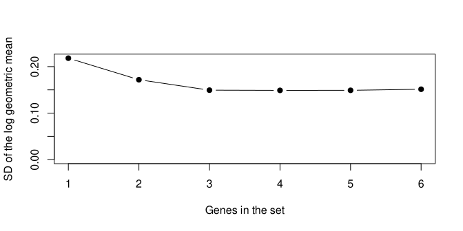
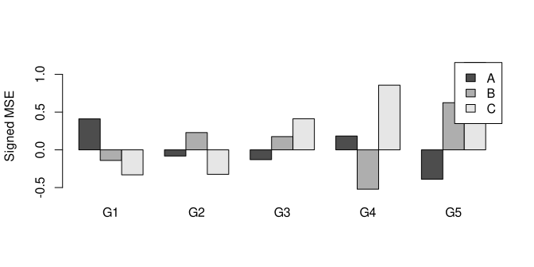

hkselect tutorial
================

## What it does

`hkselect` chooses housekeeper (reference) genes for normalizing
quantitative RT-PCR data. Within one tissue type, it fits a two-way
model of log expression with its own error variance for each gene (Model
1a) and ranks single genes and gene sets by the standard deviation of
their log geometric mean. Across tissue types, it fits a model whose
error standard deviation is a gene factor times a tissue factor, with a
tissue-specific bias for each gene (Model 2), and finds the gene set of
each size whose largest mean squared error over tissue types is
smallest.

Szabo A, Perou CM, Karaca M, Perreard L, Palais R, Quackenbush JF,
Bernard PS. Statistical modeling for selecting housekeeper genes.
*Genome Biology* 5:R59 (2004). <doi:10.1186/gb-2004-5-8-r59>. The
authors never released their code; this package was rebuilt from the
paper’s text in the [fossil](https://github.com/jeonglab-bcm/fossil)
repository.

## Install

``` r
install.packages("remotes")
remotes::install_github("jeonglab-bcm/fossil/PMC507884/package")
```

``` r
library(hkselect)
packageVersion("hkselect")
#> [1] '0.1.0'
```

## Example input

The paper’s breast cancer data: relative copy numbers of six candidate
housekeepers in 80 primary breast tumours (Additional data file 1 of the
paper).

``` r
breast <- read_expression(example_path("szabo2004_breast.csv"))
dim(breast$expr)
#> [1] 80  6
head(breast$expr, 3)
#>      MRPL19     PSMC4    SF3A1     PUM1     GAPD      ACTB
#> T1 5.098016  4.291622 16.93409 29.66253 365.7361  696.7202
#> T2 3.960391  5.962111 11.09293 21.98733 152.2613 1024.0250
#> T3 7.445535 14.016016 27.46140 29.66253 208.2142  612.7843
```

## Run the method: one tissue type

Model 1a, fitted by restricted maximum likelihood, gives each gene’s
error standard deviation on the natural-log scale, with a 95% interval.

``` r
ci <- gene_sd_ci(breast$expr)
ci[order(ci$sd), ]
#>     gene        sd     lower     upper
#> 1 MRPL19 0.2181662 0.1686598 0.2822040
#> 4   PUM1 0.2654906 0.2138126 0.3296591
#> 2  PSMC4 0.2877012 0.2346582 0.3527343
#> 3  SF3A1 0.3925864 0.3269412 0.4714122
#> 6   ACTB 0.4476910 0.3762378 0.5327141
#> 5   GAPD 0.5189317 0.4392519 0.6130654
```

The standard deviation of the log geometric mean of the best set of each
size:

``` r
sets <- best_sets(gene_sd(fit_model1(breast$expr)))
sets
#>   size                             genes        sd
#> 1    1                            MRPL19 0.2181662
#> 2    2                       MRPL19,PUM1 0.1718151
#> 3    3                 MRPL19,PSMC4,PUM1 0.1493890
#> 4    4           MRPL19,PSMC4,SF3A1,PUM1 0.1489500
#> 5    5      MRPL19,PSMC4,SF3A1,PUM1,ACTB 0.1490510
#> 6    6 MRPL19,PSMC4,SF3A1,PUM1,GAPD,ACTB 0.1513545
```

``` r
plot(sets$size, sets$sd, type = "b", pch = 19, xlab = "Genes in the set",
     ylab = "SD of the log geometric mean", ylim = c(0, max(sets$sd)))
```

<!-- -->

The paper picks the three-gene set MRPL19, PSMC4 and PUM1: the four-gene
set is barely better.

## Compare with the expected output

The expected output is the paper’s Tables 1 and 2 as printed. Gene sets
are compared as sets; Table 1 at its printed precision (0.0005) and
Table 2 within one unit in its last digit (0.0001), because its six-gene
value comes out 0.1514 against 0.1513 printed.

``` r
expected <- read.csv(example_path("szabo2004_expected.csv"), stringsAsFactors = FALSE)
t1 <- expected[expected$table == "table1", ]
t2 <- expected[expected$table == "table2", ]
sd <- gene_sd(fit_model1(breast$expr))
same_set <- function(a, b) setequal(strsplit(a, "[,;]")[[1]], strsplit(b, "[,;]")[[1]])
ok1 <- abs(sd[t1$key] - t1$value) <= 0.0005 + 1e-12
ok2 <- unname(mapply(same_set, sets$genes, t2$genes))
ok3 <- abs(sets$sd - t2$value) <= 0.0001 + 1e-12
data.frame(size = sets$size, ours = round(sets$sd, 4), paper = t2$value, set_matches = ok2)
#>   size   ours  paper set_matches
#> 1    1 0.2182 0.2182        TRUE
#> 2    2 0.1718 0.1718        TRUE
#> 3    3 0.1494 0.1494        TRUE
#> 4    4 0.1490 0.1490        TRUE
#> 5    5 0.1491 0.1491        TRUE
#> 6    6 0.1514 0.1513        TRUE
cat(sum(ok1), "of", length(ok1), "Table 1 values,", sum(ok2), "of", length(ok2), "Table 2 sets and",
    sum(ok3), "of", length(ok3), "Table 2 values match the expected output\n")
#> 6 of 6 Table 1 values, 6 of 6 Table 2 sets and 6 of 6 Table 2 values match the expected output
stopifnot(all(ok1), all(ok2), all(ok3))
```

geNorm, for comparison: its stepwise M-values give the same order as
Model 1a except that PUM1 and PSMC4 swap, and leave MRPL19 and PSMC4 as
an unordered best pair.

``` r
genorm(breast$expr)
#>     gene rank         m
#> 1 MRPL19  1.5 0.3115742
#> 2  PSMC4  1.5 0.3115742
#> 3   PUM1  3.0 0.3883429
#> 4  SF3A1  4.0 0.4717918
#> 5   ACTB  5.0 0.5219734
#> 6   GAPD  6.0 0.6185932
```

## Run the method: several tissue types

The bundled multi-tissue data are synthetic: five genes in three tissue
types of 60 samples, drawn from Model 2 with known parameters (the
paper’s multi-tissue data, from Vandesompele et al. 2002, carry no
redistribution licence).

``` r
synth <- read_expression(example_path("synthetic_tissues.csv"))
table(synth$tissue)
#> 
#>  A  B  C 
#> 60 60 60
comp <- model2_components(fit_model2(synth$expr, synth$tissue))
round(comp$sigma, 3)
#>    G1    G2    G3    G4    G5 
#> 0.203 0.254 0.287 0.412 0.502
round(comp$varsigma, 3)
#>     A     B     C 
#> 1.000 1.458 2.139
round(comp$bias, 3)
#>       G1     G2     G3     G4     G5
#> A  0.608 -0.133 -0.218  0.116 -0.372
#> B -0.230  0.302  0.029 -0.401  0.300
#> C -0.378 -0.169  0.189  0.285  0.072
```

Each gene’s mean squared error in each tissue type is its squared bias
plus its variance (the paper’s Figure 3), signed here by the bias:

``` r
m <- gene_mse(comp)
barplot(matrix(m$signed_mse, nrow = 3, dimnames = list(unique(m$tissue), unique(m$gene))),
        beside = TRUE, legend.text = TRUE, ylab = "Signed MSE", args.legend = list(x = "topright"))
```

<!-- -->

The best set of at most each size by the minimax criterion (Table 4 of
the paper):

``` r
minimax_sets(comp)
#>   size          genes       mse
#> 1    1             G2 0.3244114
#> 2    2          G1,G3 0.1822847
#> 3    3          G1,G3 0.1822847
#> 4    4    G1,G2,G3,G4 0.1608194
#> 5    5 G1,G2,G3,G4,G5 0.1115122
```

The estimates against the parameters the data were drawn from (the
expected output), allowing 15% for the standard deviations and 0.25 for
the biases (about three standard errors):

``` r
truth <- read.csv(example_path("synthetic_truth.csv"), stringsAsFactors = FALSE)
s <- truth[truth$parameter == "sigma", ]; v <- truth[truth$parameter == "varsigma", ]
b <- truth[truth$parameter == "bias", ]
kg <- do.call(rbind, strsplit(b$key, ":"))
ok <- c(abs(comp$sigma[s$key] / s$value - 1) <= 0.15, abs(comp$varsigma[v$key] / v$value - 1) <= 0.15,
        abs(comp$bias[kg] - b$value) <= 0.25)
cat(sum(ok), "of", length(ok), "parameters match the values the data were drawn from\n")
#> 23 of 23 parameters match the values the data were drawn from
stopifnot(all(ok))
```

## Your own data

- **Input:** a CSV with one row per sample: a `sample` column, a
  `tissue` column for Model 2, and one column per gene with positive
  expression levels on their original scale (relative copy numbers or
  2^-Cq; not logs). Read it with `read_expression()`, or pass a numeric
  matrix with samples in rows and genes in columns.
- **One tissue type:** `gene_sd_ci(expr)` ranks the genes (`sd` is the
  error standard deviation of the log expression);
  `best_sets(gene_sd(fit_model1(expr)))` gives the best set of each size
  and the standard deviation of its log geometric mean, roughly the
  coefficient of variation of the normalizer on the original scale.
- **Several tissue types:**
  `comp <- model2_components(fit_model2(expr, tissue))`, then
  `gene_mse(comp)` (bias, variance and MSE of each gene in each tissue
  type) and `minimax_sets(comp)`. `set_mse(comp, set, bias = "mean")`
  uses the mean of the biases of the set; the default, `"sum"`, is the
  rule that reproduces the paper’s Table 4.
- Compare models with `BIC()`: `fit_model1(expr, "common")` and
  `fit_model1(expr, "exchangeable")` are the paper’s Models 1b and 1c;
  `fit_model2()` takes the competitors it compared Model 2 with.

## The reproduction

The full reproduction of the paper (Figures 1-3, Tables 1-4 and the
claims in the text, on the paper’s data and Vandesompele et al.’s) is in
`PMC507884/` of the [fossil
repository](https://github.com/jeonglab-bcm/fossil/tree/main/PMC507884),
with its results page at
<https://jeonglab-bcm.github.io/fossil/PMC507884/>.
