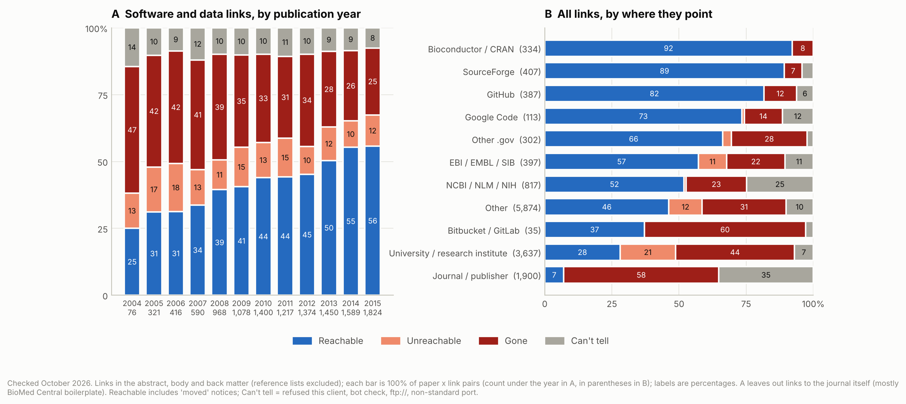
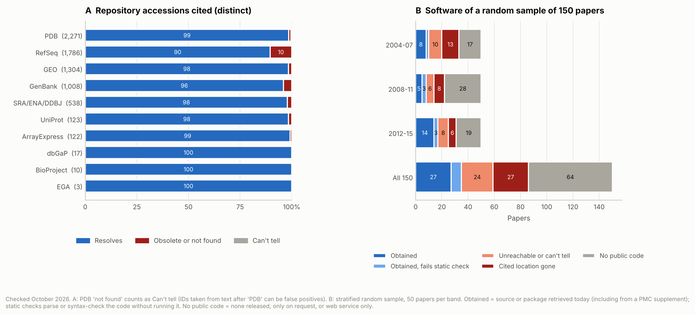

# Availability audit of 2004–2015 methodology papers

Which of the papers we could reproduce still have working software, data links and supplements?
This folder audits 7,080 open-access bioinformatics and biomedical-informatics methodology papers
published 2004–2015, all with a PubMed Central ID and full text in the PMC Open Access Subset.

## Results (checked 28 October 2026)



- **Links.** 11,356 distinct URLs in 5,255 of the 7,080 papers (74%). Leaving out links to the
  journal itself (mostly BioMed Central boilerplate), 42% of 10,369 software and data links still
  reach a page, 35% are gone and 14% do not answer; the rest
  (9%) could not be checked from here. 25% of links in 2004
  papers still work, 56% in 2015 papers. Bioconductor/CRAN (92%), SourceForge (89%) and GitHub (82%) links
  hold up; university and institute links do not (28%).
- **Hijacked domains.** 22 cited domains now serve gambling, crypto or porn, including those of
  BioMart, PlantGDB, the Human Microbiome Project DACC and Genome 10K.
- **Wayback Machine.** All 3,054 non-working links in the papers' abstracts and availability
  sections were looked up: 60% have a capture. The other 3,871 non-working links were not looked up.
- **Accessions.** 7,182 distinct accessions from 1,183 papers;
  96% resolve today. RefSeq is the exception: 177 of
  1,786 cited records are suppressed or replaced (most model XM_/XP_, bacterial YP_ and contig NT_ records).
- **Supplementary files.** All 13,720 files named in 3,484 papers are in the PMC dataset; 21 are corrupt.
  385 papers keep source code in their supplement.
- **Software sample (150 papers).** 35 can still be obtained; 52 never released
  code, 9 only on request, 3 only as a web service;
  27 point to a location that is gone and 24
  to one we could not reach or judge. Static checks of what we got found Python 2 syntax, code that GCC 13
  or glibc now reject, MATLAB or GAMS dependencies, and binary-only releases (Windows, 32-bit Linux, old Java).



`paper_audit.csv` gives each paper a readiness tier for choosing reproduction targets (first match wins):

| Tier | Meaning | Papers |
| --- | --- | --- |
| A | code in the PMC supplement | 385 |
| B | reachable own-resource link to a code host or package repository | 481 |
| C | reachable own-resource link (lab page, web service) | 779 |
| D | own-resource links dead, Wayback capture exists | 1,065 |
| E | own-resource links dead, no Wayback capture | 339 |
| F | own-resource links can't be told (blocked or untestable) | 254 |
| G | no own-resource link and no code supplement | 3,777 |

"Own-resource" links are those in the abstract or in sections whose titles mention availability,
software, implementation, download and the like. Full tables are in [`summary.md`](summary.md).

## Code lost, data still here

These are candidates for reproducing a method from the paper text alone. The code is gone or was
never released, but the input data is still available and small. [`find_data_candidates.py`](find_data_candidates.py)
writes `data_candidates.csv`: papers in tiers D, E or G whose intact data-type supplements total at
most 20 MB, or that cite a GEO, ArrayExpress or SRA accession that still resolves.

- 1,073 papers qualify.
- 227 of them have supplement captions that describe input data (a dataset, benchmark,
  training/test set or expression data).
- 51 of those 227 had code that is now lost (tiers D and E).

The ranking is heuristic: a caption can say "dataset" for a file of results.

We opened the files for these and confirmed they hold the input data:

| Paper | Method | Code status | Data in the PMC supplement |
| --- | --- | --- | --- |
| PMC1802094 (2007) | Boolean networks inferred with chi-square tests | site unreachable | toy data (18 time points × 8 genes), 43 simulated sets (7 × 40), yeast cell-cycle binary data, and the true Boolean functions as R code; under 30 kB |
| PMC3322362 (2011) | RPISeq: RNA–protein interaction prediction from sequence | server unreachable | RPI2241 and RPI369 interaction pairs (PDB chains; 36 kB) |
| PMC2958853 (2010) | Scoring function for solubility mutagenesis | page unreachable | dataset of solubility mutants and cross-validation folds (311 kB; structures from PDB) |
| PMC3027113 (2011) | NetSAP: disease-associated amino-acid substitutions | domain gone | training and independent datasets (791 kB), plus the trained models (4.9 MB) |
| PMC1955748 (2007) | ASH protein structure alignment | page 404 | training set of CATH domain IDs (23 kB; structures from CATH) |
| PMC2573020 (2008) | MEDUSA model of the yeast oxygen and heme network | page 404 | normalized, discretized and fold-change expression data (4.3 MB) and the learned model's regulators |
| PMC2063505 (2007) | EDISA biclustering of expression time series | domain gone | synthetic evaluation dataset (6.9 MB) and the gene lists of all modules |
| PMC548129 (2005) | Non-linear mapping (SOM, Sammon) of expression data | never released | leukaemia, SRBCT and Parkinson's datasets (1.9 MB), and the published maps for comparison |
| PMC3348049 (2012) | SVM for virus–human protein interactions | never released | HCV and HPV training/test sets (38 kB) |
| PMC3176265 (2011) | ΔΔG prediction from sequence and structure | never released | training and independent test sets (98 kB) |
| PMC4682424 (2015) | Positive-unlabeled learning of B-cell epitopes | never released | 92 unbound structures with annotated epitopes (~100 kB) |

## Paper catalog with citations and tags

`paper_catalog.csv` and `paper_catalog.xlsx` have one row per paper, with the audit's results as
filterable columns and tags and with citation metrics. The xlsx has filters, a frozen header,
PMC links, a Columns tab explaining every column and tag, and a Data Sources tab. It opens in
Google Sheets from Drive.

- **Citations:** NIH iCite (count, relative citation ratio, NIH percentile, expected rate), Europe
  PMC (count) and PMC (citing articles), all fetched by [`fetch_citations.py`](fetch_citations.py).
- **Subject tags:** PubMed MeSH major topics.
- **OpenAlex (count, last-five-years count, FWCI, field-normalized percentile, topic, keywords):**
  not filled yet. Without an API key, OpenAlex shares a small daily budget per network, and it was
  used up. Rerun with an API key to add these columns:
  `OPENALEX_API_KEY=... python3 fetch_citations.py openalex`.

Tags include the readiness tier (`code:in-supplement` ... `code:no-link`), `data:small-supplement`,
`data:input-described`, `data:repository`, `data:obsolete-accession`, `link:hijacked`, `cites:low`
(RCR below 0.25), `cites:high` (RCR 2 or more), `cites:none`, and `sample:<outcome>` for the 150
sampled papers. For example, 51 papers carry both `code:lost` or `code:lost-archived` and
`data:input-described`.

## Which papers

[`select_papers.py`](select_papers.py) runs two PubMed queries, both limited to 2004–2015, research
article types, and the PMC Open Access Subset (`"pubmed pmc open access"[filter]`):

| Rule | Journals | Methodology marker | Papers |
| --- | --- | --- | --- |
| `mesh` | 17 MEDLINE-indexed core journals: Bioinformatics, BMC Bioinformatics, PLoS Comput Biol, Brief Bioinform, Database (Oxford), J Comput Biol, IEEE/ACM TCBB, Stat Appl Genet Mol Biol, BMC Syst Biol, Pac Symp Biocomput, J Bioinform Comput Biol, JAMIA, J Biomed Inform, BMC Med Inform Decis Mak, Int J Med Inform, AMIA Annu Symp Proc, Methods Inf Med | MeSH `Algorithms` | 6,307 |
| `tiab` | 5 core journals not MEDLINE-indexed in this period (no MeSH): Algorithms Mol Biol, Source Code Biol Med, BioData Min, Cancer Inform, Evol Bioinform Online | `algorithm*` or `method*` in title/abstract | 773 |

Reviews, editorials, comments, letters, news, errata, retractions, congresses and biographies are
excluded. `papers.csv` lists the papers and the exact queries. Most come from BMC Bioinformatics
(3,698), PLoS Comput Biol (974), Bioinformatics (904) and BMC Syst Biol (370). Journals whose papers
are not openly licensed (J Comput Biol, IEEE/ACM TCBB, PSB, AMIA) contribute almost nothing.

## What we checked

| Step | Script | Source | Output |
| --- | --- | --- | --- |
| Full text and metadata | [`fetch_articles.py`](fetch_articles.py) | PMC Article Datasets on AWS (`s3://pmc-oa-opendata`), which PMC lists among the services allowed for automated retrieval | `cache/` (not committed) |
| URLs, accessions, supplements in each paper | [`extract.py`](extract.py) | JATS XML: abstract, body and back matter; reference lists, citations and license text dropped | `urls.csv`, `accessions.csv`, `supplements.csv` |
| Is each URL still there? | [`check_urls.py`](check_urls.py), [`classify.py`](classify.py) | One GET per distinct URL, redirects followed | `url_status.csv` |
| Is a dead URL archived? | [`check_wayback.py`](check_wayback.py) | Wayback Machine Availability API; run until every non-working own-resource link was looked up | `wayback.csv` |
| Do accessions still resolve? | [`check_accessions.py`](check_accessions.py) | NCBI E-utilities (GEO, RefSeq, GenBank, BioProject, dbGaP), ENA Browser API (SRA/ENA/DDBJ), BioStudies (ArrayExpress), RCSB (PDB), UniProt REST, EGA | `accession_status.csv` |
| Are the supplementary files intact? | [`check_supplements.py`](check_supplements.py) | Each file downloaded from the PMC dataset, MD5 checked, opened by format, archives listed for source code | `supplement_status.csv` |
| Can the software still be obtained, and does it look buildable? | [`sample_candidates.py`](sample_candidates.py), [`inspect_sample.py`](inspect_sample.py) | Stratified random sample, 50 papers per 4-year band; static checks only | `install_sample.csv`, `inspect_results.csv` |
| Tables and per-paper status | [`summarize.py`](summarize.py), [`plot_audit.py`](plot_audit.py) | All of the above | `url_audit.csv`, `paper_audit.csv`, `summary.md`, `../figures/availability_*` |

### Link categories

| Category | Meaning |
| --- | --- |
| Reachable | 2xx after redirects (including a "this has moved" notice), or the GitHub repository still exists |
| Gone | 404/410; soft 404; parked or for-sale domain; "retired" notice; deep link redirected to a site's home page or to a page many dead links funnel into; domain not in DNS (confirmed by Google Public DNS); GitHub repository not found |
| Unreachable | Host resolves but does not answer properly: connection refused or reset, timeout, 5xx, redirect loop, invalid TLS certificate (expired, wrong host, self-signed). An http:// link counts here only if HTTPS fails too |
| Can't tell | The site refused this client (401/403/429, Cloudflare or other bot checks), other 4xx; or we cannot reach it from here: ftp://, non-standard ports, GitHub user pages |

How the checker behaves, and why:

- It names itself (`fossil-link-audit/0.1 (+https://github.com/jeonglab-bcm/fossil)`) and does not
  imitate a browser. Sites behind bot protection therefore land in "can't tell", not "gone". This
  hits Oxford University Press hardest: its old `*.oxfordjournals.org` supplement links now go to
  `academic.oup.com`, which answers this client with a Cloudflare challenge.
- It does two things a current browser does: it retries an http:// link over HTTPS when plain HTTP
  fails (Chrome and Firefox upgrade navigations to HTTPS first), and it fetches a missing
  intermediate certificate from the server certificate's Authority Information Access URL when a
  server sends an incomplete chain (as UCSC's does). TLS verification is never turned off.
- Failures that can be transient (timeouts, connection errors, 5xx, 429, DNS errors) were checked a
  second time; the better result is kept. A domain counts as gone only when both the local resolver
  and Google Public DNS (DNS-over-HTTPS) return NXDOMAIN.
- The audit ran from a cloud container whose egress allows only ports 80 and 443 and whose GitHub
  access is limited: ftp:// and non-standard ports are untestable here, and GitHub links are checked
  with `git ls-remote` on the repository (so a deleted file inside a live repository still counts
  as reachable). Plain-HTTP requests pass through an egress gateway that answers
  `503 upstream connect error` when it cannot reach a server; those count as connection failures,
  not as the server's own 503.
- The Wayback lookup asks for the capture closest to 1 July of the publication year and records
  whether any capture exists. We could not download captures from this environment
  (web.archive.org itself is not reachable from it), so "archived" means "the archive lists a
  capture", not "we confirmed it contains the software".

### Accessions

GEO (GSE/GSM/GPL/GDS), SRA/ENA/DDBJ, BioProject, BioSample, ArrayExpress, dbGaP, EGA and RefSeq
accessions are matched in the paper text with patterns specific enough for free text. PDB IDs are
taken only within 80 characters after "PDB" or "Protein Data Bank", so some "not found" PDB IDs are
false positives (e.g. a year or a version number), not lost entries. GenBank and UniProt IDs are
taken only from tagged `<ext-link>` elements. Accessions in reference lists are not counted.

### Software sample

For a stratified random sample (seed 2026; 50 papers from each of 2004–2007, 2008–2011, 2012–2015)
we read each paper and recorded its primary software artifact as the paper states it, plus an
alternate (usually a code-bearing PMC supplement), in `install_sample.csv`. The `note` column says
why, for example which host failed and how.

[`inspect_sample.py`](inspect_sample.py) then obtains each artifact today (git clone, Google Code
archive, newest source file from the SourceForge project feed, direct download, or the PMC
supplement; Bioconductor, CRAN and PyPI packages are looked up in today's releases) and checks it
**without running any of it**:

| Language | Check | Counts as failing |
| --- | --- | --- |
| Python | every `.py` file parsed by Python 3.13's `ast` | Python 2 syntax (`print x`, `except X, e:`, `0777`, mixed tabs) |
| R | every `.R` file through R 4.6's `parse()`; for a package, `Depends`/`Imports`/`LinkingTo` against today's CRAN and Bioconductor | a parse error, or a dependency no longer available |
| C/C++ | each source file through `gcc`/`g++ -fsyntax-only` (GCC 13) | only errors from documented toolchain changes: standard names no longer included indirectly (GCC 13 porting notes), glibc's `getline`, old pointer-to-member call syntax. Other errors (missing defines or generated headers) are inconclusive |
| Java | class-file major version in jars | no readable classes |

A mixed project is judged by its dominant language. MATLAB, GAMS, Perl (`perl -c` would run
`BEGIN` blocks) and binary-only releases are recorded but not checked.

[`install_sample.py`](install_sample.py) would go one step further and run each build
(`BiocManager::install`, `pip install`, `configure && make`, `cmake`, `ant`, `mvn`, ...). It runs
third-party code, so it was not run in this audit; run it only in an isolated, network-restricted
container.

## Reproduce

```bash
python3 select_papers.py            # PubMed, ~1 min
python3 fetch_articles.py           # PMC S3, ~850 MB into cache/
python3 extract.py
python3 check_urls.py               # ~1.5 h; then rerun failures:
python3 check_urls.py --retry
python3 check_wayback.py            # ~1 request/s
python3 check_accessions.py
python3 check_supplements.py        # downloads ~14 GB, one file at a time, deleting as it goes
python3 sample_candidates.py        # then fill install_sample.csv by hand
python3 inspect_sample.py           # static checks; install_sample.py (runs builds) only in a sandbox
python3 summarize.py
python3 plot_audit.py
python3 find_data_candidates.py      # code lost, small data available
FOSSIL_CONTACT_EMAIL=you@example.org python3 fetch_citations.py   # add OPENALEX_API_KEY for OpenAlex
python3 build_catalog.py            # paper_catalog.csv and .xlsx
```

Link checks depend on the day and the network they run from: rerunning gives somewhat different
numbers. `url_status.csv` records when each URL was checked.
