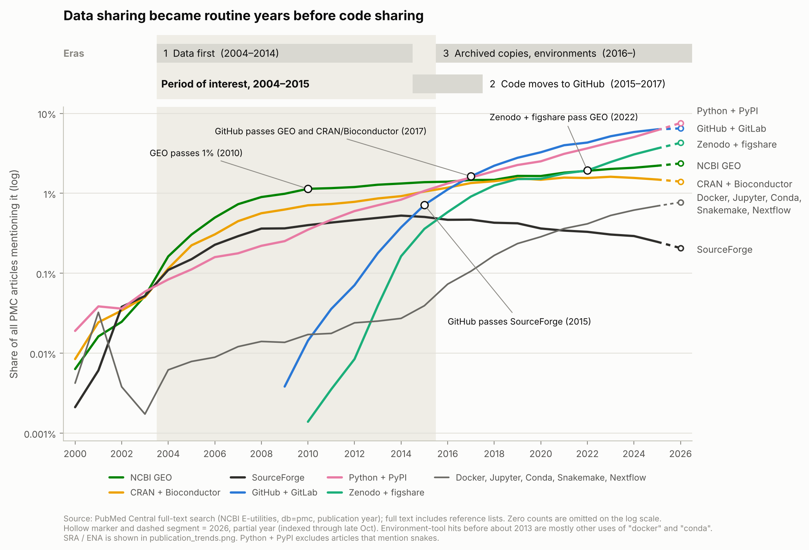
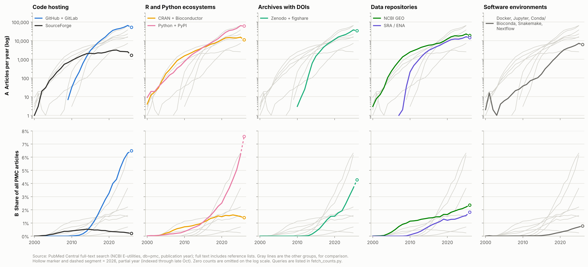

# Publication trends for code and data repositories, 2000–2026

How often PubMed Central articles mention places where code and data are shared. We use it as a
rough proxy for when sharing code and data, and so reproducibility, became common practice.

## Three eras



| Era | What happened | Evidence (share of all PMC articles) |
| --- | --- | --- |
| 1. Data first, ~2004–2014 | Data deposits became routine before code sharing did | GEO passed 1% in 2010; CRAN/Bioconductor passed 1% in 2015; SourceForge peaked at 0.53% in 2014 and never reached 1% |
| 2. Code moves to GitHub, ~2015–2017 | GitHub took over from the older venues | GitHub passed SourceForge in 2015, reached 1% in 2016, and passed GEO and CRAN/Bioconductor in 2017 |
| 3. Archived copies, environments, ~2016 onward | Archives with DOIs grew; environment tools appeared | Zenodo + figshare reached 1% in 2018 and passed GEO in 2022; environment tools reached 0.1% in 2017 |

Our period of interest is 2004–2015 (shaded): the data-first era and the year code hosting moved
to GitHub.

## By theme



| Theme | Group | Query (PMC full text, `[All Fields]`) |
| --- | --- | --- |
| Code hosting | GitHub + GitLab | `"github" OR "gitlab"` |
| Code hosting | SourceForge | `"sourceforge"` |
| R and Python ecosystems | CRAN + Bioconductor | `"cran" OR "bioconductor"` |
| R and Python ecosystems | Python + PyPI | `("python" NOT ("snake" OR "snakes" OR "boidae")) OR "pypi" OR "python package index"` |
| Archives with DOIs | Zenodo + figshare | `"zenodo" OR "figshare"` |
| Data repositories | NCBI GEO | `"gene expression omnibus" OR "ncbi geo"` |
| Data repositories | SRA / ENA | `"sequence read archive" OR "ncbi sra" OR "european nucleotide archive"` |
| Software environments | Docker, Jupyter, Conda, Snakemake, Nextflow | `"docker" OR "jupyter" OR "conda" OR "bioconda" OR "snakemake" OR "nextflow"` |

Each query is ANDed with `<year>[pdat]`. Row B divides by all PMC articles with that publication
year (`<year>[pdat]`), so PMC's growth does not drive the trend. Each column is one theme; the
other groups are drawn in gray for comparison.

Caveats:

- PMC full text includes reference lists, so a citation of a GitHub-hosted tool counts as a mention.
- PMC covers only part of the literature, and its coverage has changed over time (for example,
  journals joining PMC and public access policies).
- 2026 is a partial year (indexed through late October). The raw count for 2026 is therefore low.
  The share is more comparable, but may still change as indexing catches up.
- A mention is not a deposit. An article can name GitHub or GEO without sharing code or data.
- Python + PyPI is almost all "python": PyPI alone is named in about 0.1% of articles. Excluding
  articles that mention snakes drops a few Python-software papers too.
- Row A omits zero counts, since a log axis cannot show them.
- Early hits for some terms are other uses of the word. For example, the 16 "docker" hits in 2001 are
  medical articles (occupational medicine, primary care), not the container tool.

## Reproduce

```bash
python3 fetch_counts.py counts.csv   # about 250 NCBI E-utilities requests, ~3 min
python3 plot_trends.py counts.csv publication_trends
python3 plot_eras.py counts.csv publication_eras
```

The plotting scripts need matplotlib. `counts.csv` holds the counts we retrieved and the date we
retrieved them.
